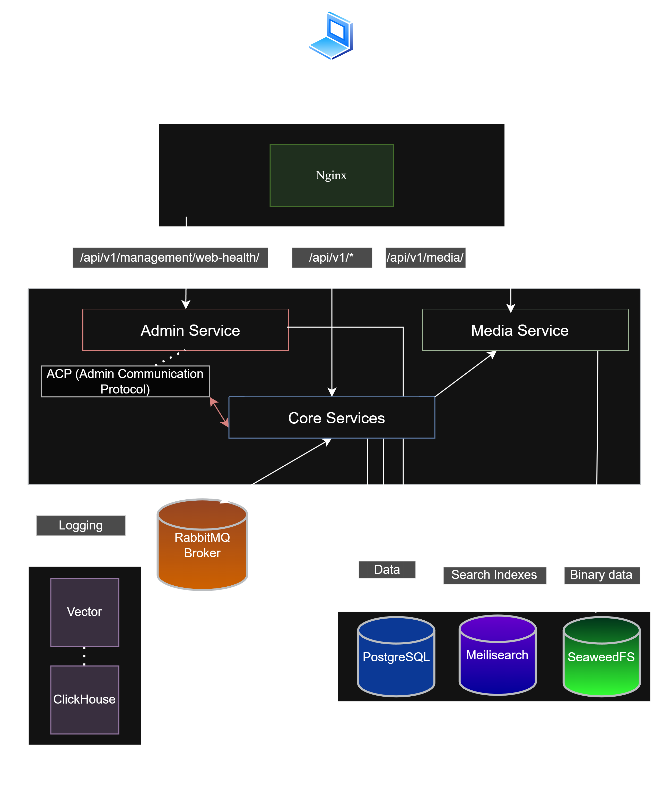
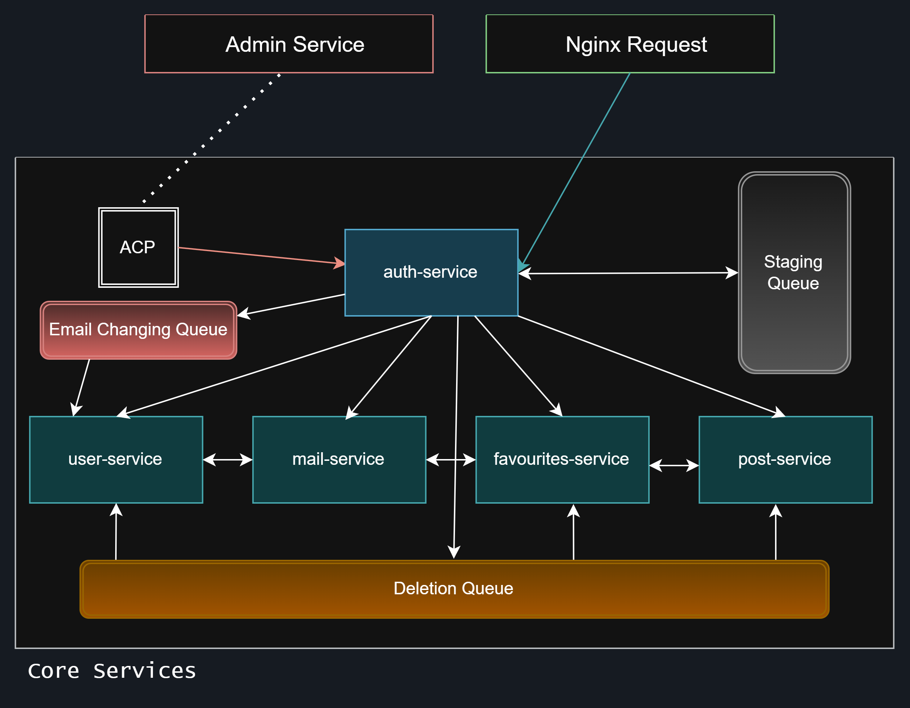
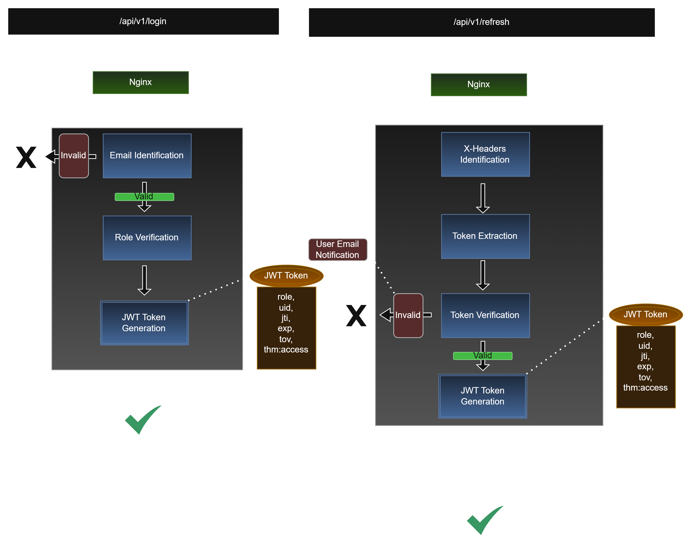
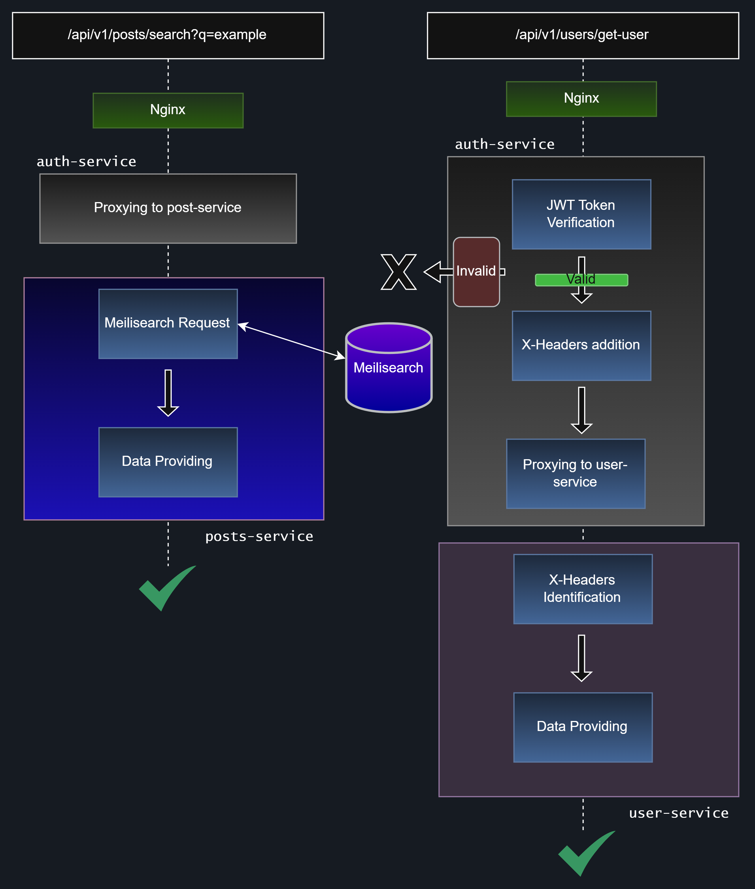
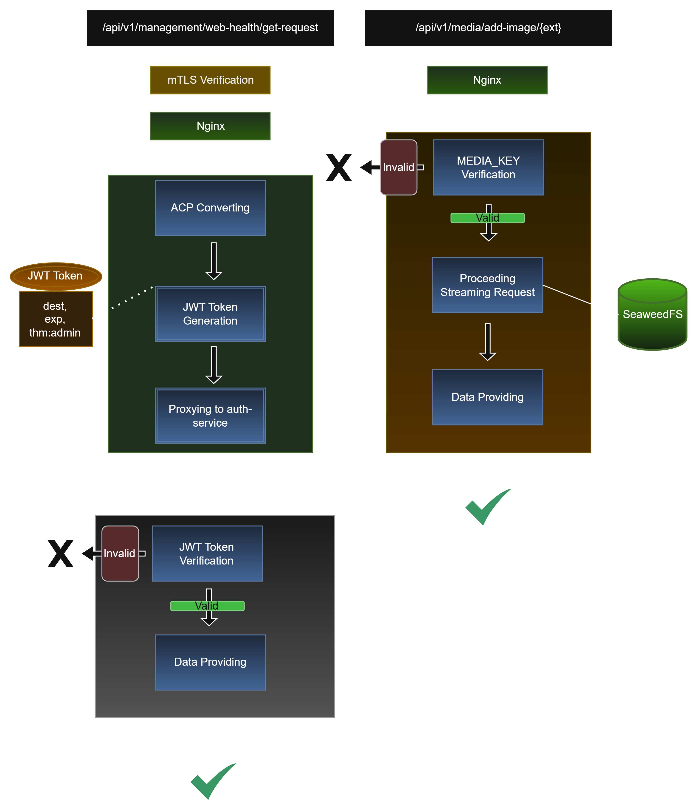
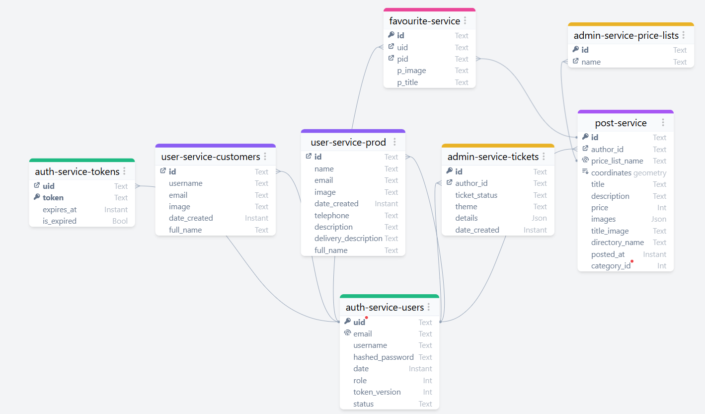

# Iceberg-Market: Commercial Backend Infrastructure

> **Check Sequence:** `---`
> **Role:** Solo Lead Backend & DevOps Engineer
> **System Status:** Production-Ready Microservices Backend (Frontend Integration Phase)
##  1. Executive Summary & Scope

**Business Context:**  
Development of E2E backend and full server infrastructure setup for ad aggregator website "Iceberg-Market". Target audience is wholesale business owners from Sochi, Russia. Major business requirements: relevant ad feed, useful admin-panel for ad uploading, multi-stage registration procedure.

**Engineering Scope:**  
The project has **[microservice architecture](#microservice-architecture-and-perimeter-security-with-centralized-authentication-gateway-app-structure)**, communication protocol: HTTP/REST. App main framework: [FastAPI](#fastapi-major-framework). Additional services [Meilisearch](#search-engine-meilisearch) for fast search, [RabbitMQ](#message-broker-rabbitmq) for event-driven communication, [SeaweedFS](#object-storage-seaweedfs) for media storage, [ClickHouse/Vector](#high-speed-logging-clickhousevector) for logging, [PostgreSQL](#postgresql-dbms) for data storage) are presented as separate services. Supplementary libraries ([Alembic and SQLAlchemy](#secondary-db-stack-sqlalchemy--alembic)) are presented as standard dependencies. The whole infrastructure is based on [Docker](#infrastructure-docker--docker-compose) containers and orchestrated by [Docker Compose](#infrastructure-docker--docker-compose).


*Repository name was depersonalized upon the client's request.
Actual commit history can be seen in the "Activity" section.

## Repository Structure

```
├── docker-compose.yml      # Containers deployment configuration
├── init-db/                # Database initialization
├── .env.example            # Environment test configuration
├── vector.yaml             # Vector initialization
├── initial.sql             # ClickHouse initialization
├── docs/                   # Schemas and documentation
├── services/               # App services logic
```

---

##  2. Architecture & Tech Stack Features

### 1. Module Communication Details


 - For admin-service and core-services interaction - application protocol **[ACP](#acp-admin-communication-protocol)** (Admin Communication Protocol) was devised over standard HTTP/REST. For communication between other services standard HTTP/REST is used.
 - In case of POST/DELETE requests to media-service: the service requests an [API Key](#api-key-access-to-media-service) which is held only by services that are allowed to add or delete images. The API Key is loaded into the container RAM on every startup.
 - Media-service has no DB connection as it's a layer of abstraction over SeaweedFS and provides an API to other services without any specific business logic.
 
---
### 2. Features of inter-service communication


- Single Entry Point for all requests to core-services/admin-service is auth-service, establishing [Perimeter Security with Centralized Authentication Gateway](#microservice-architecture-and-perimeter-security-with-centralized-authentication-gateway-app-structure) architecture. After successful user JWT token verification, the service creates trusted headers (X-User-Id and X-Role) and proxies the request to the internal isolated network. Subsequent user verification takes place via trusted headers.
- User deletion, email changing and scheduled tasks occur through RabbitMQ usage.
	- Upon user deletion, auth-service sends a message with the user's X-User-Id to Deletion Queue; then the user-service/post-service/favourite-service read the message and start the deletion operation. The task goes to the FastAPI background tasks so the user receives an immediate response
	- Upon email changing, auth-service sends a message with the user's X-User-Id to Email Changing Queue; on the next step user-service reads the message and updates the data.
	- Upon any scheduled tasks (email confirmation) auth-service sends a message with the user's X-User-Id to Staging Queue; upon email confirmation, subsequent user registration proceeds; otherwise, the account is deleted after a while.
- Favourite-service data is updated via caching and subsequent requests to post-service when cache expires.


---

## 3. Requests Flow Presentation

#### 1. Auth-service architecture



- The majority of requests to auth-service do not demand a JWT as they do not require trusted X-Headers for identification ("/api/v1/registration", "/api/v1/login", "/api/v1/forgot-password",  "/api/v1/user-confirm").
- For user authentication stateless token is used - JWT. The private key is based on modern standard ES256 (using elliptic curves). JWT access tokens are issued only via two endpoints (/api/v1/login and /api/v1/refresh). Access token has claims (role, uid: user_id, jti: JSON token id, exp: expires_in, tov: token_version, thm: theme_of_token).
- The thm claim is mandatory for all types of JWT and determines the type of token
- In case an expired refresh token is extracted during the user identification procedure, all tokens will be deactivated and an email about potential fraud will be sent to their email.
- The tov claim is used for user sessions control using stateless JWT. If user logs out (or performs another action requiring user's session deactivation), refresh-token in database will be deactivated and token_version field will be incremented.
### 2. Internal services architecture



- Interaction with the search system proceeds via the /api/v1/posts/search endpoint, accepting query parameters (q: query, fil: filter, sort, limit, page).
- For filtering the Meilisearch query language is used. Requests are created on the client side and sent in the fil query parameter.
- The sort parameter is available only for two types of data (date and price) and can be "desc" or "asc".

### 3. External modules architecture



- External services are separated from the main cluster by the API Gateway routing. They do not require user identification and therefore can work without auth-service.
- To minimize RAM consumption, a [streaming image processing method](#image-streaming-overall-architecture) is used. This approach is applied in the majority of scenarios ([the exception is primary image processing during ad uploading](#5-other-architecture-features)).
- Data transfer via the ACP (Admin Communication Protocol) occurs through transmitting a JWT from the admin-service to the auth-service. Admin-type tokens have claims (dest: destination, exp: expires_at, thm:admin). Admin-type tokens are issued only on the admin-service side. The dest claim takes one of nine values depending on service and operation. The first byte is the operation byte and the second byte is the first letter of the target service.
- For access to the admin panel (path /api/v1/management/web-health) users undergo mTLS verification. Certificates are issued by the system administrator.
---
- ##### **FastAPI (Major Framework):**
  	 The framework is modern and lightweight and supports asynchronous execution. It is loosely coupled with components, allowing developers to manage and control the technology stack on their own. The framework provides autodocumentation for endpoints (OpenAPI/Swagger), increasing developer productivity.
     
- ##### **PostgreSQL (DBMS):**
	 The system supports asynchronous requests to the database (if using the asyncpg driver), and can store data in JSON format. It runs as a server and is available for running as a Docker container, simplifying the integration of all services into a single cluster.
     
- ##### **Secondary DB Stack (SQLAlchemy + Alembic):**
   	 Tools provide convenient interaction with the database. SQLAlchemy is a standard ORM which allows developers to write SQL queries in Python code. That is a more secure and proper way to interact with the database. Alembic is a version control system which allows developers to make data migrations in case of changes in table structure.
     
- ##### **Search Engine (Meilisearch):**
  	 The search engine enables users to make index search instantly. It supports fuzzy search, allowing users to search using approximate data. The system provides a convenient query language for data filtering.
     
- ##### **Object Storage (SeaweedFS):**
   	 A distributed media storage system which supports file streaming and asynchronous operations.
     
- ##### **Message Broker (RabbitMQ):**
  	 A message broker that allows developers to avoid request cascades in microservice architectures, thereby reducing network latency. It provides temporary queues which are used for scheduled tasks (such as user deletion in case of an unverified email). The system guarantees message delivery even if the target service is unavailable.
     
- ##### **High-Speed Logging (ClickHouse/Vector):**
  	 A columnar database for business analytics, has high performance and is able to add new data extremely fast.
     
- ##### **Infrastructure (Docker / Docker Compose):**
  	 A system of virtualization and orchestration for efficient dependency management and establishing microservice architectures. Docker allows developers to create containers with an already configured environment, guaranteeing reliable execution of the target logic on every system with Docker. Docker Compose is an orchestration system, allowing developers to create isolated networks of containers which interact using internal names; that enables developers to create architectures like Perimeter Security with Centralized Authentication Gateway.
     
- ##### **Microservice Architecture and Perimeter Security with Centralized Authentication Gateway (App Structure):**
  	 An architecture where every logic element in a system is a separate container (separating method depends on a project). Such an architecture allows developers to create clusters of containers, isolated at the network level (interacting using internal names). The technology stack (programming languages, etc.) could be different on every container as containers interact in accordance with the API a container provides and the chosen protocol (HTTP, gRPC, etc.). The Perimeter Security with Centralized Authentication Gateway Architecture is a special case of microservice architecture which allows developers to define a single point of access to an isolated network, transmitting trusted data to the internal logic. This architecture prevents attacks on internal services (as containers are isolated), substantially reducing the attack surface.
     
- ##### **ACP (Admin Communication Protocol):**
  	 An application protocol based on HTTP/REST for transmitting messages from admin-service to auth-service. The protocol provides authorized (temporary) access to specific segments of the system. It is based on transmitting a JWT with operation-byte (dest claim, second symbol in payload), destination-byte (dest claim, first symbol in payload), expiration claim (exp), to minimize damage in case of token interception. Example: destination byte "a" (auth-service), operation byte "v" (verify), with exp (expires) in 5 minutes.
     
- ##### **API Key (Access to media-service):**
  	 A measure for preventing unauthorized access to the service with access to critical app infrastructure (database with media) by restricting access to some endpoints (for creating, modifying or deleting data in media-service) by validating the master-key on every request. Services which are allowed to use these endpoints contain this key in headers. This approach is easy to implement and establishes a basic level of security.
     
- ##### **Lazy Polling Using Cache (Favourites-Service):**
  	 A method of data updating using the lazy loading method with data caching. When some ad is being requested the service checks whether valid cache exists; if yes, it returns the response; if not, it makes a request to the post-service, caches it and then returns it to the user. The cache has an expiration period (15 minutes) and must be updated when it expires. This approach is effective and reduces the number of network requests.
      
- ##### **mTLS Verification (Access to admin-service):**
  	 A method that ensures authorized access to the admin-service for a restricted group of users using client certificate verification at the browser level. The administrators issue and distribute certificates at their discretion. This approach significantly reduces the attack surface as unauthorized requests cannot pass through the proxy.
        
- ##### **Image Streaming (Overall Architecture):**
  	 A method of transmitting files in batches of fixed size. This approach is memory-efficient as files are processed in streaming mode and never fully loaded into RAM.
---
## 5. Other Architecture Features

- **Category Storage:** 
	- Category storage is implemented using dictionaries (static storage type). The key is the category sequence number and the value is a dictionary defining the category type and referencing the parent category (parent_id).
	- If a category is a root category, the parent_id parameter is set to 0.
	- If a category is a leaf category, the is_leaf parameter is set to true.
	    
- **Admin panel with an automated function of loading price-lists and managing data:** 
	- The admin panel has price list upload functionality.
	- Stage 1: Uploading the archive according to the specification (files init.csv, posts.csv and the img directory)
		- The initialization file describes the price list itself (name and the author ID)
		- The ad file describes ads and media related to them (without media option is also available); while the img directory stores images.
	- Stage 2: Parsing and processing data:==
		- At this stage all attributes are validated for compliance with the chosen category
		- Before sending to the media-service, media files are watermarked and checked whether they comply with platform regulations.^44d052
	- Stage 3: sending data to the post-service:
		- The data is sent via the ACP protocol and added to the database.
    
- **User Group Separation:**
- The system has two primary groups and one additional group:
        
	- USERS Group (Group 1 PRIMARY) - users who have completed the registration procedure (account creation + email confirmation); they have access to their profiles, can add ads to favourites, edit account details or search ads.
	    
	- PRODUCTION Group (Group 2 PRIMARY) - users who have completed the advanced registration procedure (account creation + email confirmation + manager approval); They have the same abilities as USERS + ability to add ads (currently, listings are published by a manager on behalf of the user).
        
	- OTHER Group (Group 0 ADDITIONAL) - users who have not completed any registration procedures. They can search ads and add them to favourites (using cookies).
    
---

## 6. Database ERD



### Features of database structure

- For favourite-service data updating denormalization principle in data storage was used. Fields p_image and p_title duplicate title_image and title respectively.
- Each microservice owns its part of database which is a logically segmented part of the primary database.
- The admin-service has no direct access to the databases of other services. Access is provided only through requests to the endpoints /api/v1/manip.

---
##  7. Local Setup Instructions


```
# 1. Clone repository
git clone https://github.com/kernlock64/Project-f15bc00f-30dd-412c-b27f-24f37ca49097.git

cd Project-f15bc00f-30dd-412c-b27f-24f37ca49097.git

# 2. Configure environment
cp .env.example .env

# 3. Configure environment
chmod -R +x .

# 4. Launch application infrastructure
docker-compose up -d --build

```
